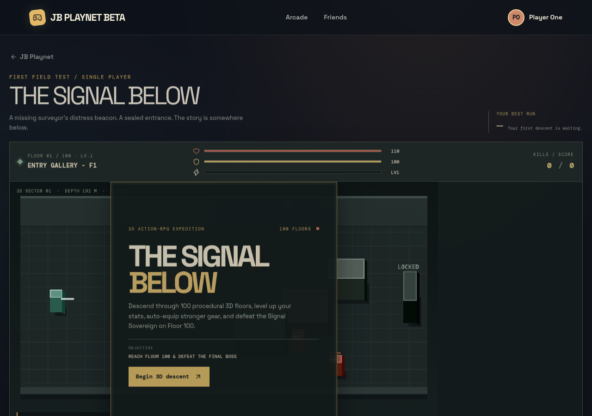
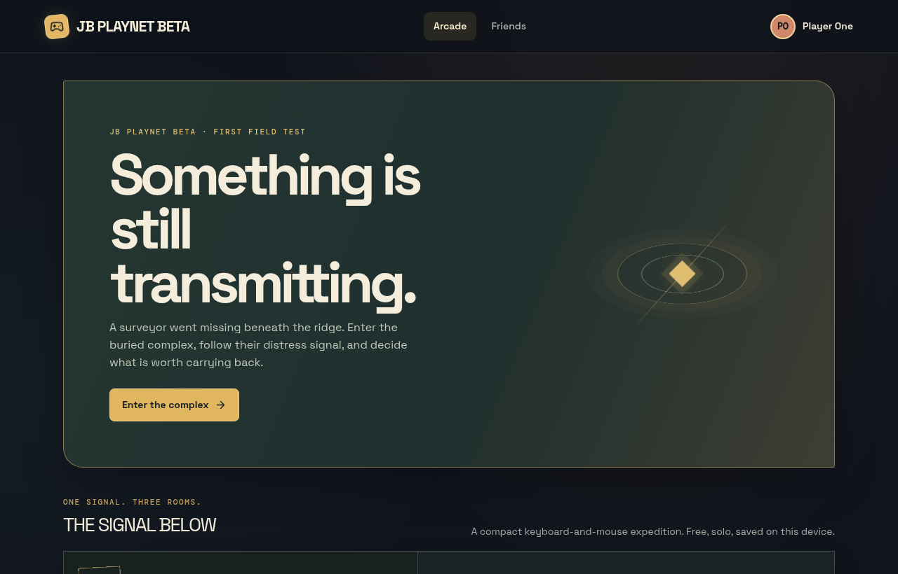
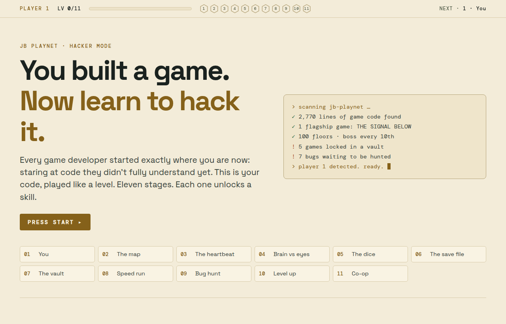

<p align="center">
  
</p>

<h1 align="center">THE SIGNAL BELOW</h1>
<p align="center"><b>Something is still transmitting.</b></p>

<p align="center">
  <a href="https://signal.gamelab.link"><b>▶ PLAY NOW · signal.gamelab.link</b></a><br>
  <sub>Free · no account · runs in your browser · keyboard + mouse</sub>
</p>

---

A surveyor went missing beneath the ridge. You followed their distress signal into a buried complex, and the entrance sealed behind you.

**100 floors down, something is still sending that signal.** Go find out what.

## What you're in for

- 🏚️ **100 floors, never the same twice.** Every run builds a brand-new dungeon from dice rolls.
- 💀 **A named boss every 10th floor, each with its own move.** Start with **VANCE-01, the Iron Warden**, and its shockwave slam. The **Signal Sovereign** waits on Floor 100.
- 🔗 **Beat a boss, unlock a Signal Link.** Next run, warp straight back to that floor.
- 🛡️ **Wardens hit harder.** Watch the wind-up, then dodge or guard at the right moment.
- 💎 **Loot from Common to Legendary.** Better gear equips itself automatically, and the deeper you go, the luckier the drops.
- 🔧 **Fuse duplicates.** Three of a kind become one stronger one: 3 → 9 → 27.
- 🧑‍🚀 **Unlock new suits.** Extract alive from Floor 20, 50 and 100 to earn new surveyor skins.
- 🚪 **Bank it or risk it.** After every cleared floor, extract and bank your loot, or descend for more. Fall in battle and you lose everything you didn't bank.
- 🔥 **Beat Floor 100?** Overdrive mode keeps going.
- 🎨 **New in v3.0:** all-new pixel art for the surveyor, the bosses, the enemies and the rooms.

## Controls

| Action | Keys |
|---|---|
| Move | `W` `A` `S` `D` |
| Slash | `Left click` or `J` |
| Guard | `Right click`, `K` or `Shift` |
| Dodge | `Space` |
| Interact | `E` |
| Next floor | Clear the room, then walk into the Extraction Lift on the right |

## The loot math (straight from the code)

Every drop rolls 0 to 100, plus a depth bonus of half a point per floor (it maxes out at 44, on floor 88). Here's what that means:

| Floor | Common | Uncommon | Rare | Epic | Legendary |
|---|---|---|---|---|---|
| 1 | 51.5% | 28% | 20.5% | 0% | **0%** |
| 25 | 39.5% | 28% | 22% | 10.5% | **0%** |
| 50 | 27% | 28% | 22% | 20% | **3%** |
| 75 | 14.5% | 28% | 22% | 20% | **15.5%** |
| 88+ | 8% | 28% | 22% | 20% | **22%** |

> Legendary gear **can't drop until floor 45**. How deep are you willing to go for it?

## Challenge the squad

Your best run is saved in your browser. **Screenshot it and drop it in the group chat.**

- Who can survive the **Guardian Chamber** on floor 10?
- Who's first to bank a **Legendary**?
- Who actually reaches the **Signal Sovereign**?

<p align="center">
  
</p>

## 🔒 Coming soon: the vault

Five more games are already built and locked in the vault, waiting for launch:

**Snake** · **Memory** · **Tic-Tac-Toe** · **2048** · **Zombie Sniper** (3D)

## Peek inside the code

Want to see how it works, or build your own? Start with **[Signal Hacker](https://signal.gamelab.link/docs/)**, an interactive guide to this game's code in 11 stages: the game loop, the loot dice, the room generator, the save file, the vault, and a board of real bugs you can hunt.

<p align="center">
  
</p>

## Run it yourself

You'll need [Node.js](https://nodejs.org/).

```bash
cd project-bolt-stackblitz-starters-kppnjtxg/project
npm install
npm run dev
```

Then open the address it prints (usually `http://localhost:5173`).

## 📰 What's new

### v3.0 · Pixels & Husks

- 🎨 **Pixel-art glow-up.** Your suit, the bosses, the enemies, the rooms. All redrawn.
- 🧟 **Meet the Husks.** The old guards got mutated. They're not friendly.
- 🏹 **Husk Archers shoot, then run.** Get close and they bail.
- 🌀 **Husk Phasers teleport.** Watch for the laser line first.
- 💥 **Floor 20: the Riot Architect.** Explosive bolts. Keep moving.
- 🦇 **Floor 30: the Flyer Matriarch.** Two flyers every 3 seconds. Good luck.
- 🎯 **Training deck gets pixels too.** Smack the boss dummy. Warm up first.

### v2.6 · The foundation

- ⚔️ Slay guardians for gold and gems.
- 🔧 Upgrade gear slots for good.
- 🧬 Fuse duplicates: 3 → 9 → 27.
- 📦 Collect all 105 items.

## Where things live

```
project-bolt-stackblitz-starters-kppnjtxg/project/
├─ src/
│  ├─ App.tsx                        lobby, pages, and the router
│  ├─ components/BuriedComplexGame.tsx  the game screen: drawing + controls
│  └─ lib/
│     ├─ deep-signal-engine.ts       the brain: rooms, enemies, bosses, loot, every frame
│     └─ Pixel-skins.ts              the pixel art: suits, bosses, enemies, rooms
└─ docs/                             Signal Hacker + the Field Manual
```

## Built with

React · TypeScript · Vite · HTML canvas · three.js · Tailwind CSS

---

<p align="center"><b>JB Playnet</b> · Found a bug? <a href="https://github.com/Dadlorian/signal-below/issues">Open an issue</a> and it might end up on the bug-hunt board.</p>

---

## THE DADLORIAN RULES

**You're the hacker in this house.** You build stuff that runs on other people's screens. That's real power.

**My job: make sure you don't hurt yourself. Or anyone else.**

> [!IMPORTANT]
> **RULE 0 // YOUR CODE IS YOUR CODE**
>
> I never touch it. No fixes. No cleanup.
> **This is the Way.**

### RULE 1 // WATCH YOUR PACKAGES

> [!WARNING]
> **A new package is a stranger moving into your code.**

Every library is somebody else's code. It runs on *your* laptop. Then in your friends' browsers.

Hackers hide in packages with friendly names. One wrong install can infect your laptop. Then you pass it to everyone who plays.

I scan them. **You should know them too.**

- `package.json` is your list
- Adding a new one? Look it up on npmjs.com first. Who made it? Who uses it?
- Don't need it? **Don't install it.**

### RULE 2 // NEVER TURN TEXT INTO CODE

> [!CAUTION]
> **Text in. Code out. Game over.**

Only a few tricks let outsiders run their code in your game:

```js
eval(...)
new Function(...)
element.innerHTML = someVariable
```

Feed one a sneaky string and they're inside your friend's browser.

Check yourself: `grep -rn "eval(\|new Function(\|innerHTML" src/`

### RULE 3 // NEW CODE DOESN'T RUN UNTIL IT'S SCANNED

That's how real game studios ship. It's called **CI/CD**. Yours looks like this:

```text
ZIP  >  SCAN  >  SEALED BOX  >  TEST COPY  >  LIVE  >  UNDO BUTTON
```

- **SCAN:** I read your code without running it.
- **SEALED BOX:** Docker builds and serves your game. Not my server.
- **LIVE:** Cloudflare is free. It gives your game a real web address, squeezes the files small, and keeps copies close to your friends. That's why it loads fast.
- **UNDO:** every release keeps the last version ready.

> [!NOTE]
> A scan isn't magic. It catches the usual tricks, not everything. **Stay sharp.**

> [!TIP]
> **You're ahead of most people your age.** You know how a game reaches the internet. You know where hackers try to get in. Keep it up.
